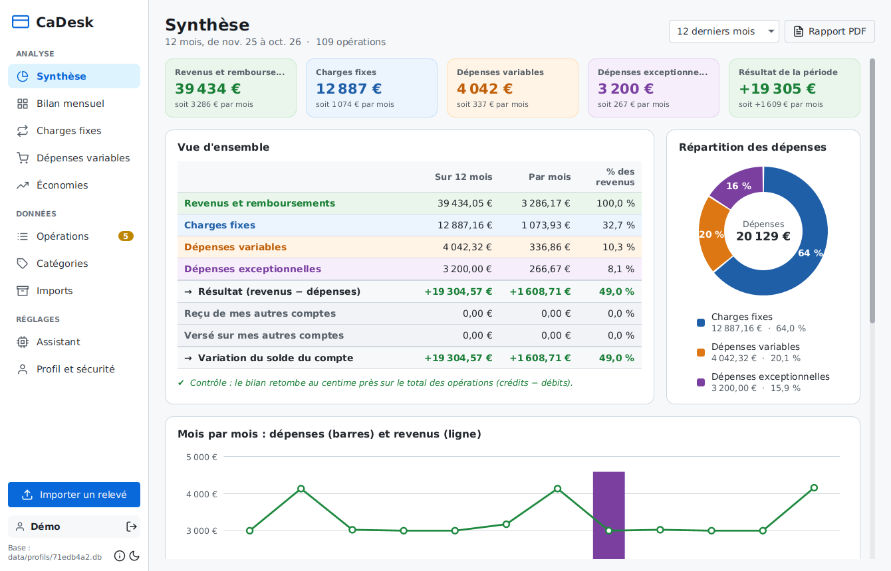
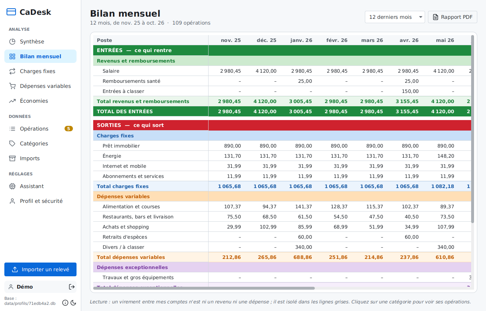
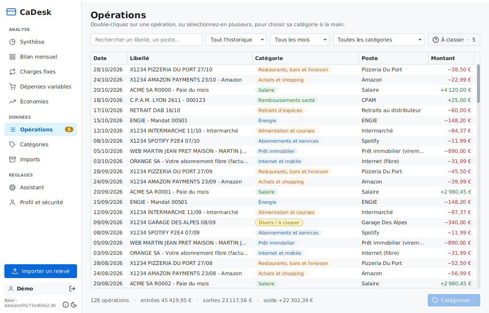
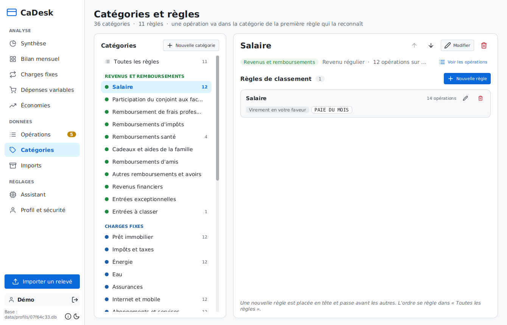

# CaDesk

Application de bureau pour **Linux et Windows** qui importe les relevés du Crédit Agricole (CSV ou OFX) dans une
base **SQLite**, classe chaque opération dans une catégorie et en tire un bilan : ce qui rentre, ce qui sort, les
charges fixes, les dépenses variables et ce qu'il est possible d'économiser.

Les relevés peuvent se recouvrir : réimporter un fichier, ou importer un relevé dont la période chevauche un
import précédent, n'ajoute que les opérations réellement nouvelles.

Plusieurs personnes peuvent utiliser l'application : chacune a son **profil**, avec sa propre base de données,
qu'elle peut protéger par un mot de passe et chiffrer. Un **assistant** peut s'appuyer sur un modèle de langage
(LLM) de votre choix pour classer les opérations, et chaque période s'exporte en **rapport PDF**.

Pour installer et utiliser l'application sans rien savoir de sa technique : le
**[guide d'utilisation](docs/guide-utilisateur.md)**. Ce fichier-ci s'adresse à qui la construit ou la modifie.

## Aperçu

<p align="center">
  
  
</p>
<p align="center">
  
  
</p>

De gauche à droite et de haut en bas : la **synthèse**, le **bilan mensuel**, les **opérations** et les
**catégories** avec leurs règles. Les données sont fictives : ce sont celles du jeu de démonstration des tests.
Le [guide d'utilisation](docs/guide-utilisateur.md) montre d'autres écrans.

## Lancer l'application

| Système | Commande                            |
|---------|-------------------------------------|
| Linux   | `./start.sh`                        |
| Windows | `start.bat` (double-clic possible)  |

Rien d'autre n'est à installer : le projet **embarque son JDK** (Eclipse Temurin 25, dernière LTS), un pour
chaque système, dans `jdk/`. Au premier lancement, l'application est construite automatiquement.

`start.bat --console` lance l'application dans la console, pour voir les messages en cas de problème.

### Un dossier autonome, à emporter

```
./package.sh               # construit l'application (tests compris), puis assemble app_clean/
./package.sh -DskipTests   # tout argument est transmis à Maven
```

`app_clean/` contient tout ce qu'il faut pour lancer l'application, et rien du projet : le programme
(`cadesk.jar`), ses bibliothèques (`lib/`), Java pour Linux et pour Windows (`jdk/`, allégé de ce qui ne sert
qu'à développer), le guide d'utilisation (`docs/`) et ses propres lanceurs, `start.sh` et `start.bat`. Le dossier
pèse 680 Mo ; il se déplace, se renomme et se copie où l'on veut, d'un système à l'autre. Les données y sont
rangées dans `app_clean/data` : elles le suivent, et un nouvel assemblage ne les efface pas.

Le dossier est une copie : `target/app` reste en place, et `./start.sh` continue de lancer le projet. À savoir :

- sous Windows, si le dossier est sur un partage réseau, les données vont dans `%LOCALAPPDATA%\CaDesk`
  (voir « Données ») ;
- le moteur de GitHub Copilot, s'il est utilisé, s'installe à la première utilisation dans le dossier personnel
  de l'utilisateur (voir « GitHub Copilot ») : c'est la seule chose que l'application écrit hors de son dossier.

### Poste Windows où les fichiers `.bat` sont bloqués

Certaines stratégies d'entreprise (AppLocker) interdisent d'exécuter les fichiers `.bat` et `.cmd` : Windows
affiche alors « Ce programme est bloqué par une stratégie de groupe ». Les exécutables restant autorisés,
l'application se lance directement avec le JDK embarqué, depuis PowerShell, une fois construite par `./build.sh` :

```powershell
$cadesk = '\\wsl.localhost\Ubuntu-22.04\home\moi\cadesk'   # dossier du projet
& "$cadesk\jdk\windows-x64\bin\javaw.exe" --module-path "$cadesk\target\app\cadesk.jar;$cadesk\target\app\lib;$cadesk\target\app\lib\windows" `
  --add-modules copilot.sdk.runtime '--enable-native-access=javafx.graphics,org.xerial.sqlitejdbc' "-Dcadesk.home=$cadesk\." `
  -m cadesk/io.github.pierre3119.cadesk.ui.Main
```

C'est exactement la commande que contient `start.bat`. Depuis WSL, `./start.sh` reste le plus simple : la fenêtre
s'affiche sur le bureau Windows. Pour le dossier autonome, la commande est la même sans `target\app\`, avec
`$cadesk` pour le dossier `app_clean`.

## Les écrans

Une **période** se choisit en haut de chaque écran de bilan : les 12 derniers mois (par défaut), une année
civile, tout l'historique, ou **entre deux dates** — deux champs de date apparaissent alors ; une date laissée
vide est sans limite. Il n'y a rien à valider : une date s'applique dès qu'un jour est choisi dans le
calendrier ; saisie au clavier, dès la touche Entrée ou en quittant le champ. Le sous-titre de l'écran rappelle
alors les dates retenues (« Du 18/01/2026 au 12/06/2026 · 44 opérations »). Les moyennes « par mois » divisent
par le nombre de mois de la période. L'écran
**Opérations** a le même choix, pour son propre filtre ; les deux dates sont communes à toute l'application.

| Écran                  | Ce qu'il montre                                                                                   |
|------------------------|---------------------------------------------------------------------------------------------------|
| **Synthèse**           | Chiffres clés, vue d'ensemble, répartition des dépenses, évolution mois par mois, 12 premiers postes |
| **Bilan mensuel**      | Entrées et sorties par catégorie et par mois, sous-totaux, solde du mois et solde cumulé          |
| **Charges fixes**      | Chaque charge : nombre de paiements, période observée, évolution des montants, dernier montant    |
| **Dépenses variables** | Par catégorie, puis les 30 plus gros postes (commerçants, bénéficiaires)                          |
| **Économies**          | Capacité d'épargne constatée, simulateur à objectifs réglables, pistes tirées des opérations      |
| **Opérations**         | Toutes les opérations avec leur catégorie ; recherche, filtres, classement à la main              |
| **Catégories**         | Paramétrage des catégories et des règles de classement                                            |
| **Imports**            | Ce que chaque fichier importé a apporté à la base                                                 |
| **Assistant**          | Choix du modèle de langage, et passe de recatégorisation des opérations déjà importées            |
| **Profil et sécurité** | Nom, mot de passe, chiffrement, rôle ; sauvegarde et vidage de la base ; gestion des profils      |

Dans les écrans de bilan, un clic sur une catégorie ou un poste ouvre la liste de ses opérations. Le bouton
**(i)**, en bas de la barre latérale et dans le choix du profil, ouvre « À propos » : la version de
l'application et son auteur.

### Rapport PDF

À côté du choix de la période, le bouton **Rapport PDF** exporte le rapport complet de la période affichée
(12 derniers mois, année, entre deux dates ou tout l'historique). Il reprend, écran par écran, les chiffres et
les graphiques de l'application : synthèse (chiffres clés, vue d'ensemble, anneau des dépenses, graphique
mensuel, premiers postes), bilan mensuel, charges fixes, dépenses variables, économies (avec vos objectifs du
simulateur) et, si vous le demandez, la liste des opérations. Au-delà de douze mois, le bilan mensuel est
découpé en tableaux de douze mois.

Le bilan sépare cinq **natures** : revenus et remboursements, charges fixes, dépenses variables, dépenses
exceptionnelles, et virements entre vos propres comptes — ces derniers ne sont ni un revenu ni une dépense et
sont suivis à part. Une ligne de contrôle vérifie que le bilan retombe au centime près sur la somme des
opérations.

## Profils

Chaque utilisateur a son profil : sa base de données, ses catégories, ses règles, ses réglages. À l'ouverture,
l'application demande quel profil ouvrir — sauf s'il n'y en a qu'un et qu'il n'a pas de mot de passe : il
s'ouvre alors directement. La base de l'application d'avant les profils devient le premier profil, là où elle
est. Le profil ouvert est rappelé en bas de la barre latérale ; le bouton à sa droite le ferme pour en choisir
un autre. Tout se règle dans l'écran **Profil et sécurité**.

- **Mot de passe** (facultatif) : il est demandé à l'ouverture du profil. Seule une empreinte en est conservée.
- **Chiffrement** (facultatif, demande un mot de passe) : la base du profil est chiffrée en AES-256 par une clé
  tirée au hasard, **propre à ce profil**, que le mot de passe déverrouille. Sans chiffrement, le mot de passe
  n'est qu'une porte : la base reste un fichier SQLite lisible par qui a accès à l'ordinateur.
- **Vider la base** : supprime les opérations, les comptes et l'historique des imports du profil ; une case
  permet de supprimer aussi les règles et de remettre les catégories dans leur état de départ. La place libérée
  est rendue : rien ne subsiste dans le fichier.
- **Sauvegarde** : enregistre la base du profil dans une archive `.zip` ; une base chiffrée y reste chiffrée.
  **Restaurer une sauvegarde** (dans le choix du profil, ou pour un administrateur dans la liste des profils)
  recrée les profils de l'archive à côté des profils existants, sans rien remplacer ; chacun retrouve le mot
  de passe qu'il avait au moment de la sauvegarde.

### Administrateur

Un profil qui a un mot de passe peut devenir **administrateur** : librement s'il n'y en a encore aucun, sinon
avec l'accord d'un administrateur, qui saisit son propre mot de passe. Un administrateur peut :

- **ouvrir tous les profils** sans leur mot de passe, y compris les profils chiffrés ;
- **réinitialiser un mot de passe** oublié ;
- supprimer un profil, en créer, restaurer une sauvegarde ;
- faire une **sauvegarde globale** : tous les profils dans une seule archive.

Pour les profils chiffrés, cela repose sur une **clé de secours** : chaque administrateur a une paire de clés,
et chaque profil chiffré conserve un exemplaire de sa clé chiffré pour chacun d'eux. La clé privée de
l'administrateur est elle-même chiffrée par son mot de passe. Les clés de secours sont mises à jour à chaque
ouverture d'un profil chiffré : un profil chiffré avant qu'il y ait un administrateur ne lui devient
accessible qu'une fois rouvert par son propriétaire. L'écran du profil indique toujours qui détient une clé de
secours. **Sans administrateur, le mot de passe oublié d'un profil chiffré rend ses données définitivement
illisibles.**

Quand un administrateur consulte le profil d'un autre, un bandeau le rappelle ; le mot de passe, le
chiffrement et le rôle de ce profil ne se modifient que par son propriétaire.

## Assistant (LLM)

L'assistant classe les opérations que les règles ne reconnaissent pas. Il regroupe les opérations en
*activités* (même commerçant ou tiers, même type, même sens), puis pour chacune :

1. si la même activité est déjà classée dans la base, elle prend cette catégorie — sans interroger le modèle ;
2. sinon le modèle de langage choisit parmi **vos catégories**, dont il reçoit des exemples d'activités ; il
   ne propose une catégorie nouvelle que si aucune ne convient, et un même nom n'est créé qu'une fois.

Le modèle se choisit dans l'écran **Assistant** : OpenAI, Anthropic (Claude), Mistral, Google Gemini,
**GitHub Copilot**, Ollama (modèle local), ou tout service compatible avec l'interface d'OpenAI (adresse, clé
d'API, nom du modèle ; « Lister » interroge le service, « Tester la connexion » vérifie les réglages). Ces
réglages sont propres au profil.

- **À l'import** : si la case « Classer automatiquement… » est cochée, les opérations nouvelles que les règles
  ne reconnaissent pas sont classées par l'assistant, et le bandeau en rend compte. La case **Classer avec
  l'assistant**, sous le bouton d'import, coupe et remet ce classement d'un clic. Un import réussit toujours,
  que le modèle réponde ou non.
- **Recatégoriser** : une passe réexamine les opérations déjà importées, sur tout l'historique ou entre deux
  dates — seulement celles à classer, toutes sauf celles classées à la main, ou toutes. Rien n'est modifié
  d'office : les changements proposés sont présentés, et seuls ceux que vous cochez sont appliqués.

Une catégorie attribuée par l'assistant est enregistrée avec l'opération, comme un choix manuel, et se
reconnaît à son icône dans l'écran **Opérations** ; elle se corrige de la même façon.

**Confidentialité** : pour classer une activité, son type, son libellé bancaire et un montant sont envoyés au
service choisi, avec le nom de vos catégories et de commerçants déjà classés. Avec Ollama, rien ne quitte
l'ordinateur. La clé d'API (ou le jeton GitHub) est enregistrée dans la base du profil : elle n'est protégée
que si le profil est chiffré.

### GitHub Copilot

Avec un abonnement GitHub Copilot, l'assistant peut se servir des modèles que cet abonnement propose. Dans
l'écran **Assistant** :

1. choisir le service **GitHub Copilot** — il n'y a pas d'adresse à saisir ;
2. cliquer sur **Se connecter à GitHub…** : la page de GitHub s'ouvre dans votre navigateur par défaut ; vous y
   autorisez la connexion, et le jeton revient de lui-même dans l'application, qui l'enregistre dans le profil ;
3. « Lister » donne les modèles permis par l'abonnement ; en choisir un, tester, enregistrer.

Chaque question posée au modèle est décomptée de l'abonnement, comme une demande faite dans Copilot.

**La connexion par le navigateur** est celle de Copilot CLI (`copilot login`), menée par le moteur de Copilot
que l'application embarque : rien n'est à créer sur GitHub.

- GitHub présente la demande au nom de Copilot CLI, et le jeton délivré a les permissions que Copilot CLI
  demande : Copilot, mais aussi la lecture et l'écriture de vos dépôts. L'application ne s'en sert que pour
  Copilot ; il est enregistré dans la base du profil comme une clé d'API — **chiffrez le profil** pour le
  protéger.
- La page renvoie vers l'application, qui l'attend sur l'ordinateur : le navigateur doit donc tourner sur le
  même ordinateur (sous WSL, celui de WSL). Sinon, ou si la page n'aboutit pas, le lien « Se connecter avec un
  code » de la boîte de dialogue affiche un code à saisir sur github.com/login/device, depuis n'importe quel
  navigateur.
- Pour retirer l'accès : « Oublier ces réglages » efface le jeton du profil ; côté GitHub, il se révoque dans
  *Settings › Applications › Authorized OAuth Apps* (ce qui déconnecte aussi Copilot CLI). GitHub ne garde que
  les dix derniers jetons délivrés à une même application : au-delà, les plus anciens cessent de fonctionner.

**Sans passer par le navigateur**, le champ « Jeton GitHub » accepte un jeton d'accès personnel *à permissions
fines* (`github_pat_…`), créé sur github.com dans *Settings › Developer settings › Personal access tokens ›
Fine-grained tokens* avec la seule permission de compte **Copilot Requests** : c'est le jeton le plus limité.
Les jetons classiques (`ghp_…`) ne sont pas acceptés par Copilot.

Copilot n'a pas d'interface de simple question-réponse : l'application embarque son SDK officiel et le
**moteur de Copilot CLI**, un agent conçu pour lire des fichiers et lancer des commandes. Elle ne s'en sert
que comme d'un modèle :

- le moteur est un programme à part, lancé au moment de classer ou de se connecter et arrêté aussitôt après ;
  à la première utilisation, il s'installe dans `.copilot/runtime-cache` de votre dossier personnel (200 Mo),
  ce qui prend quelques secondes ;
- **aucun outil** ne lui est accordé et toute demande de permission est refusée : un libellé bancaire tourné
  comme un ordre ne peut rien lui faire lire ni exécuter ;
- il n'utilise ni la connexion ni les réglages d'un Copilot CLI ou d'un `gh` installés sur l'ordinateur, et les
  variables d'environnement de Copilot et de GitHub lui sont retirées : seul sert le jeton du profil ;
- sa télémétrie est coupée, et ses fichiers — le fil des échanges, qui reprend les opérations à classer, et le
  jeton le temps d'une connexion — vont dans un dossier temporaire supprimé dès que le travail est fini. Si
  l'application est arrêtée brutalement en plein travail, ce dossier est supprimé à l'utilisation suivante de
  Copilot.

## Importer un relevé

Bouton **Importer un relevé**, ou glisser-déposer du fichier sur la fenêtre (plusieurs fichiers à la fois sont
acceptés). Le bandeau indique ce que l'import a apporté ; l'écran **Imports** en garde l'historique.

Deux formats de téléchargement du Crédit Agricole sont lus, reconnus au contenu du fichier, un compte par
fichier :

- **CSV** (« Liste des opérations ») : chaque opération en entier — date d'opération et date de valeur, type,
  libellé complet (nom du commerçant, références) ;
- **OFX** : un résumé — la date d'opération, le montant, et un libellé réduit à sa première ligne. Le type de
  l'opération et son libellé sont reconstitués à partir des champs `NAME` et `MEMO` ; faute de date de valeur, la
  date d'opération en tient lieu.

Les deux se mélangent : une opération apportée par un relevé OFX est complétée (libellé, date de valeur) par le
relevé CSV qui la contient ; une opération connue par un relevé CSV n'est jamais appauvrie par un relevé OFX.

### Comment les doublons sont évités

Les relevés n'ont pas d'identifiant d'opération commun aux deux formats, et deux opérations distinctes peuvent
être strictement identiques (deux virements de même montant et de même motif le même jour). Le rapprochement
raisonne donc en quantités, pour chaque groupe d'opérations de même date, montant et type : chaque ligne du
fichier y prend une opération de la base, la plus ressemblante d'abord (même libellé et même date de valeur,
puis même libellé, puis libellé dont l'un commence par l'autre, puis n'importe laquelle).

1. une ligne qui trouve une opération identique est **connue** et ignorée — une seule fois par opération en
   base : si le fichier en contient deux et la base une, la seconde est ajoutée ;
2. une ligne qui trouve une opération dont le libellé ou la date de valeur diffère est la même opération, que la
   banque a retouchée ou qu'un relevé OFX avait apportée : elle est **modifiée**, sans créer de doublon — sauf si
   la ligne vient d'un relevé OFX, qui en sait moins que la base et ne la modifie jamais ;
3. une ligne qui ne trouve plus d'opération dans son groupe est **ajoutée**.

Un import est tout ou rien : un fichier invalide ne modifie pas la base, et le message indique la ligne en cause.

## Catégories et classement

Les catégories et les règles de classement sont **enregistrées dans la base** et se règlent dans l'écran
**Catégories** : rien n'est figé dans le code.

Une opération est classée ainsi :

1. si vous avez choisi sa catégorie **à la main** — ou si l'**assistant** lui en a attribué une —, c'est elle
   qui compte ;
2. sinon, les **règles** sont essayées dans l'ordre : la première qui reconnaît l'opération donne sa catégorie ;
3. sinon, l'opération va dans la catégorie par défaut de son sens — « Divers / à classer » pour une sortie,
   « Entrées à classer » pour une entrée. Le nombre d'opérations en attente est rappelé dans la barre latérale.

Le classement par les règles n'est pas enregistré : il est recalculé à chaque affichage. Créer, modifier ou
réordonner une règle s'applique donc aussitôt à tout l'historique, et aux imports à venir.

### Une règle

Une règle reconnaît une opération si son **type** est le bon (« Paiement par carte », « Prélèvement »… ou tous les
types) et si l'un de ses **mots-clés** figure dans le libellé.

- Majuscules et accents sont ignorés ; un seul mot-clé suffit.
- `A + B` exige les deux textes (par exemple un fournisseur et un numéro de contrat).
- Entre guillemets, une espace finale compte : `"DR "` reconnaît « CABINET DR » mais pas « DRIVE ».
- Sans mot-clé, la règle prend toutes les opérations de son type.
- Pour un paiement par carte, le mot-clé est cherché dans le nom du commerçant, pas dans le numéro de carte ni
  la date.

Le **poste** est le nom donné aux opérations reconnues (« Spotify », « Carburant ») ; laissé vide, c'est le nom du
commerçant ou du tiers, tiré du libellé. Une nouvelle règle est placée en tête ; l'ordre se modifie dans
« Toutes les règles ».

### Classer à la main

Dans **Opérations**, un double-clic (ou une sélection multiple puis **Catégoriser…**) ouvre le choix de la
catégorie. La case « Classer aussi les opérations semblables » crée au passage une règle à partir du commerçant
ou du tiers : les opérations déjà importées qui lui correspondent sont reclassées, et les prochaines le seront.
« Classement automatique » annule un choix manuel, ou une catégorie attribuée par l'assistant.

### Une catégorie

Chaque catégorie a un nom, une nature et, pour un revenu, une régularité (régulier, remboursement, ponctuel) qui
sert à l'écran **Économies**. Supprimer une catégorie supprime ses règles ; ses opérations sont reclassées par
les autres règles ou, à défaut, reviennent dans « à classer ». Les deux catégories par défaut peuvent être
renommées mais pas supprimées.

### Catégories de départ

Une base neuve — donc **chaque nouveau profil** — reçoit 36 catégories générales (script
`src/main/resources/db/migration/V2__categories.sql`) et **aucune règle** : les règles dépendent de vos
commerçants et de vos tiers. Au premier import, toutes les opérations arrivent donc dans « à classer » :
classez-les à la main en créant des règles au passage, ou laissez l'assistant le faire. Un profil déjà créé garde
ses catégories et ses règles : elles sont dans sa base.

## Données

Les données sont dans le dossier `data/` du projet :

```
data/profils.json          registre des profils : nom, rôle, fichier de la base, empreinte du mot de passe,
                           clés des administrateurs (la clé privée y est chiffrée) — aucune donnée bancaire
data/comptes.db            base du premier profil, celle de l'application d'avant les profils
data/profils/<id>.db       base de chacun des profils créés ensuite
```

La base d'un profil non chiffré est un fichier SQLite ordinaire. Celle d'un profil **chiffré** est un fichier
propre à l'application : un en-tête, puis l'image de la base chiffrée en AES-256-GCM. Elle n'est jamais écrite
en clair sur le disque : l'application la déchiffre en mémoire à l'ouverture, et réécrit le fichier chiffré
après chaque modification. Un profil chiffré ne s'ouvre donc que dans une fenêtre de l'application à la fois.
L'application affiche toujours, en bas de la barre latérale, le chemin de la base du profil ouvert.

Chiffrer un profil existant supprime les copies en clair que l'application avait laissées à côté de sa base
(copies de sécurité d'avant mise à niveau). Elle ne peut rien contre les traces que l'ancien fichier en clair
aurait laissées ailleurs : sauvegardes personnelles, corbeille, espace libre du disque.

**Exception sous Windows** : si le projet se trouve sur un partage réseau — c'est le cas d'un projet WSL ouvert
par `\\wsl.localhost\…` — SQLite ne peut pas y verrouiller un fichier. Les données sont alors placées dans
`%LOCALAPPDATA%\CaDesk\`. Dans cette configuration, Linux et Windows ont donc **chacun leurs profils**. Si
l'application y avait déjà rangé des données du temps où elle s'appelait « Comptes CA », dans
`%LOCALAPPDATA%\ComptesCA\`, elle continue de s'en servir là où elles sont.

Pour choisir un autre emplacement : variable d'environnement `CADESK_DB` ou propriété `-Dcadesk.db=/chemin/comptes.db`.
Elle désigne la base du premier profil ; son dossier devient le dossier des données.
Le dossier `data/` est exclu de Git : il contient des données personnelles. Pensez à le sauvegarder — l'écran
**Profil et sécurité** le fait profil par profil, ou en une fois pour un administrateur.

**Rien de bancaire ne va dans le dépôt.** Le fichier `.gitignore` écarte les bases et ce qui les accompagne
(`data/`, `*.db`, `profils.json`), les relevés téléchargés (`*.csv`, `*.ofx`, `*.qif`), et ce que l'application
produit — rapports `*.pdf`, sauvegardes `*.zip` — où qu'ils se trouvent dans le projet. Les tests et les images
du guide n'utilisent que des relevés fictifs, fabriqués par le code.

Les montants sont stockés en centimes entiers (crédit positif, débit négatif) et les dates au format ISO.

**Mise à niveau** : quand une nouvelle version de l'application modifie le schéma, la base est d'abord copiée à
côté d'elle (`comptes.db.sauvegarde-v2` pour une base au schéma 2), puis mise à niveau. Si tout va bien, cette
copie peut être supprimée. La copie d'une base chiffrée est chiffrée elle aussi.

## Construire et tester

```
./build.sh                # Linux   : compilation, tests, distribution dans target/app
build.bat                 # Windows
./build.sh -DskipTests    # tout argument est transmis à Maven
./build.sh verify         # en plus : couverture des tests et analyse statique (ce que fait l'intégration continue)
./package.sh              # construction, puis dossier autonome app_clean/ (voir « Lancer l'application »)
```

Une seule construction, sous l'un ou l'autre système, produit une distribution valable pour les deux : elle
contient les parties natives de Linux et de Windows — JavaFX et le moteur de GitHub Copilot, ce dernier pesant
80 Mo par système — et chaque lanceur prend les siennes.

Après une modification du code, relancez `build` : les lanceurs ne reconstruisent que si la distribution est absente.

Les tests n'utilisent que des relevés fictifs. Options :

- `-Dcadesk.sample.csv=/chemin/releve` ajoute des contrôles sur un vrai relevé, CSV ou OFX (import complet,
  réimport sans aucun ajout, classement, cohérence du bilan) et affiche ses totaux, sans rien en conserver dans
  le projet ;
- `-DexcludedGroups= -Dgroups=ui` parcourt l'application hors écran : chaque écran et chaque boîte de dialogue
  est rendu en image (`target/ui-snapshots`) et les actions sont exécutées de bout en bout — classement à la
  main, par une règle et par l'assistant (avec un modèle de langage simulé), connexion à GitHub (avec un faux
  moteur de Copilot et un navigateur simulé), période entre deux dates, rapport PDF, profils, sauvegarde,
  vidage de la base, « À propos ». Ce test est exclu par défaut ; sans affichage (serveur, intégration
  continue), ajoutez `-Dglass.platform=Headless -Dprism.order=sw` : JavaFX rend alors les écrans en mémoire.
  Les images du guide d'utilisation et de ce fichier en viennent :
  `cp target/ui-snapshots/guide/*.png docs/images/`.

Aucun test n'appelle un vrai service de modèle de langage, ni GitHub : les échanges HTTP sont joués contre un
faux serveur local, et GitHub Copilot — questions comme connexion — contre un faux moteur, lancé comme le vrai,
qui note ce qu'il reçoit. Pour que les
tests restent rapides, la dérivation des clés y est allégée (propriété `cadesk.kdf.iterations`,
fixée dans `pom.xml` pour les tests seulement ; 600 000 itérations dans l'application).

Un test, `LauncherTest`, lance l'application comme le font les lanceurs — son module, sur les bibliothèques de
la distribution, avec les mêmes options — et lui fait dérouler un profil, un import, le rapport PDF et une
connexion à GitHub ; un avertissement journalisé par une bibliothèque y est une erreur. Les autres tests
tournent dans une JVM qui dispose d'office de modules que le lanceur ne charge que s'ils sont déclarés dans
`module-info.java` : une déclaration oubliée ne se voit que dans celui-ci. C'est pourquoi les bibliothèques
sont copiées dans `target/app/lib` avant les tests.

### Contrôles de qualité

| Contrôle                         | Quand                 | Ce qui fait échouer la construction                               |
|----------------------------------|-----------------------|-------------------------------------------------------------------|
| Compilation (`-Xlint:all`)       | toujours              | un avertissement du compilateur                                   |
| Tests unitaires                  | toujours              | un test en échec                                                  |
| Couverture (JaCoCo)              | `verify`              | moins de 90 % des instructions exécutées par les tests, hors interface |
| Analyse statique (SpotBugs)      | `verify`              | un défaut probable, ou une faille repérée par Find Security Bugs   |

Ce que l'analyse statique signale et qui est voulu est écarté cas par cas, avec sa raison, dans
`spotbugs-exclude.xml`. Les rapports sont dans `target/site/jacoco/` et `target/spotbugsXml.xml`.

### Intégration continue

Sur GitHub, deux flux de travail (`.github/workflows/`) vérifient chaque envoi sur `main` et chaque demande de
fusion :

- **CI** — sous Linux et sous Windows : `./mvnw verify` (les contrôles ci-dessus), puis les tests de
  l'interface hors écran ; les rapports et les images sont joints à l'exécution. Une demande de fusion qui ajoute
  une dépendance connue pour être vulnérable est refusée, et l'arbre complet des dépendances est envoyé à GitHub
  pour que ses alertes de sécurité couvrent aussi celles qu'amènent les bibliothèques.
- **CodeQL** — analyse de sécurité et de qualité du code, aussi lancée chaque semaine ; ses résultats sont dans
  l'onglet « Security » du dépôt.

Dependabot (`.github/dependabot.yml`) propose chaque semaine les mises à jour des bibliothèques, des greffons
Maven et des actions. Les actions sont épinglées par leur empreinte, et le Maven Wrapper vérifie par leur
empreinte SHA-256 l'archive de Maven et la sienne (`.mvn/wrapper/maven-wrapper.properties`) : à mettre à jour
avec la version de Maven.

## Organisation

```
start.sh, start.bat        lanceurs du projet
build.sh, build.bat        construction (Maven Wrapper + JDK embarqué)
package.sh                 construction, puis assemblage du dossier autonome app_clean/
jdk.env                    version, adresses et empreintes SHA-256 des JDK embarqués
scripts/jdk.sh, jdk.bat    téléchargement vérifié du JDK s'il est absent
scripts/standalone/        lanceurs du dossier autonome
docs/                      guide d'utilisation et ses images
.github/                   intégration continue (workflows/) et mises à jour (dependabot.yml)
spotbugs-exclude.xml       ce que l'analyse statique signale et qui est voulu
jdk/                       JDK embarqués (non versionnés, recréés automatiquement)
data/                      registre des profils et bases (non versionnés)
app_clean/                 dossier autonome (non versionné, recréé par package.sh)
src/main/java/io/github/pierre3119/cadesk/
    domain/                opérations, catégories, règles, montants
    statement/             lecture des relevés du Crédit Agricole, CSV et OFX
    importer/              rapprochement et import
    categorize/            classement des opérations d'après les règles
    analysis/              bilan d'une période : par catégorie, par mois, par poste ; pistes d'économies
    db/                    base SQLite (fichier, ou image en mémoire d'une base chiffrée), schéma versionné
    security/              mot de passe, chiffrement, coffre d'une base chiffrée
    profile/               profils, sessions, administrateurs, sauvegarde et restauration
    llm/                   assistant de classement et accès aux modèles de langage
    report/                rapport PDF
    ui/                    interface JavaFX
src/main/resources/db/migration/   scripts de schéma (V1 : opérations ; V2 : catégories et règles ;
                                   V3 : origine de la catégorie enregistrée avec une opération)
```

## Technique

- Java 25, application modulaire (`module-info.java`) ; JavaFX 27 avec le thème AtlantaFX ; icônes Ikonli.
- SQLite via `sqlite-jdbc` ; le schéma est versionné par `PRAGMA user_version` et migré à l'ouverture.
- Chiffrement avec les seuls algorithmes du JDK : clé tirée du mot de passe par PBKDF2-HMAC-SHA256 (600 000
  itérations, sel aléatoire) ; données en AES-256-GCM, avec une clé de données aléatoire par profil ; clé de
  secours des administrateurs en RSA-3072 (OAEP, SHA-256). L'en-tête d'une base chiffrée est authentifié avec
  son contenu, et toute écriture se fait par remplacement du fichier d'un seul geste.
- Modèles de langage par HTTP (`java.net.http`), JSON avec Gson ; GitHub Copilot par son SDK officiel pour Java
  (`com.microsoft:copilot-sdk`, qui amène Jackson et JNA), dont le moteur natif (`copilot-sdk-runtime`, un par
  système dans `lib/linux` et `lib/windows`) tourne dans un processus séparé ; les lanceurs l'ajoutent aux
  modules par `--add-modules copilot.sdk.runtime`. La connexion à GitHub passe par l'interface de connexion
  de ce SDK, encore marquée expérimentale : elle peut changer avec une prochaine version du SDK.
- Rapport PDF avec Apache PDFBox, graphiques vectoriels et polices standard du format PDF.
- Relevés OFX lus sans bibliothèque : le fichier est parcouru comme une suite d'événements (balise ouverte,
  balise fermée, texte), ce qui convient à l'OFX 1 de la banque, dont les valeurs ne sont pas refermées, comme
  à la forme XML d'OFX 2. L'identifiant `FITID` des opérations n'est pas utilisé : les relevés CSV n'en ont
  pas, et le rapprochement doit valoir pour les deux formats.
- Le classement et le bilan sont du code pur, sans interface ni base, couverts par des tests unitaires ; les
  graphiques (anneau, barres empilées et ligne) sont dessinés par l'application.
- Maven 3.9 via le Maven Wrapper (`mvnw`), téléchargé dans `~/.m2` à la première construction, empreintes
  vérifiées.
- Les JDK sont épinglés dans `jdk.env`. Pour changer de version, remplacez-y la version, les adresses et les
  empreintes : les scripts téléchargent la nouvelle au lancement suivant. Seule l'architecture x86-64 est prévue.

## Limites connues

- Seuls les téléchargements du Crédit Agricole sont reconnus : la « liste des opérations » en CSV, et l'OFX, un
  compte par fichier. Un relevé OFX ne donne ni la date de valeur ni le détail des libellés : préférez le CSV
  quand vous avez le choix.
- Un nouveau profil n'a aucune règle (voir « Catégories de départ ») : au premier import, toutes les opérations
  sont à classer, à la main ou par l'assistant.
- Les catégories et les règles sont communes à tous les comptes d'un profil.
- Le mot de passe oublié d'un profil chiffré ne se récupère pas : seul un administrateur désigné auparavant
  peut le réinitialiser (voir « Administrateur »).
- La base d'un profil chiffré est réécrite en entier à chaque modification : c'est imperceptible pour des
  relevés bancaires (quelques mégaoctets), mais ce n'est pas fait pour une base volumineuse.
- L'assistant envoie des libellés bancaires au service de modèle de langage choisi (voir « Confidentialité ») ;
  la qualité du classement dépend du modèle, d'où la validation demandée avant toute recatégorisation.
- GitHub Copilot : la connexion d'un Copilot CLI déjà installé n'est pas reprise — chaque profil se connecte
  pour lui-même, ou reçoit un jeton à permissions fines —, et seul github.com est prévu (pas GitHub
  Enterprise). Le jeton d'une connexion par le navigateur a les permissions de Copilot CLI, plus larges que ce
  dont l'application a besoin. Le moteur n'est présent
  que dans la distribution lancée par `start.sh` ou `start.bat` : lancée autrement (depuis un environnement de
  développement), l'application signale qu'il est absent. Il alourdit la distribution de 160 Mo.
- Le rapport PDF utilise les polices standard du format : les rares caractères hors de l'alphabet d'Europe de
  l'Ouest y sont remplacés par « ? ».
- « 12 derniers mois » désigne les douze mois civils qui se terminent par le dernier mois importé : si ce mois
  est incomplet, ses totaux et les moyennes mensuelles sont un peu sous-estimés.
- Sur une fenêtre étroite, les tableaux les plus larges défilent horizontalement.
- Sous Windows, lancer le projet depuis un partage WSL (`\\wsl.localhost\…`) fonctionne, mais le démarrage y est
  plus lent que depuis un disque local, et la base est alors distincte de celle de Linux (voir « Données »).
- Les lanceurs Windows (`start.bat`, `build.bat`) ne s'exécutent pas sur un poste dont la stratégie bloque les
  fichiers batch (voir plus haut).
- Le dossier autonome `app_clean/` embarque Java pour les deux systèmes, d'où ses 680 Mo ; seule l'architecture
  x86-64 est prévue.

## Auteur

**Pierre Duloy** — [LinkedIn](https://www.linkedin.com/in/pierre-duloy-2101929/) ·
[GitHub](https://github.com/pierre3119)

Ces liens se retrouvent dans l'application, sous le bouton **(i)** (« À propos »).
