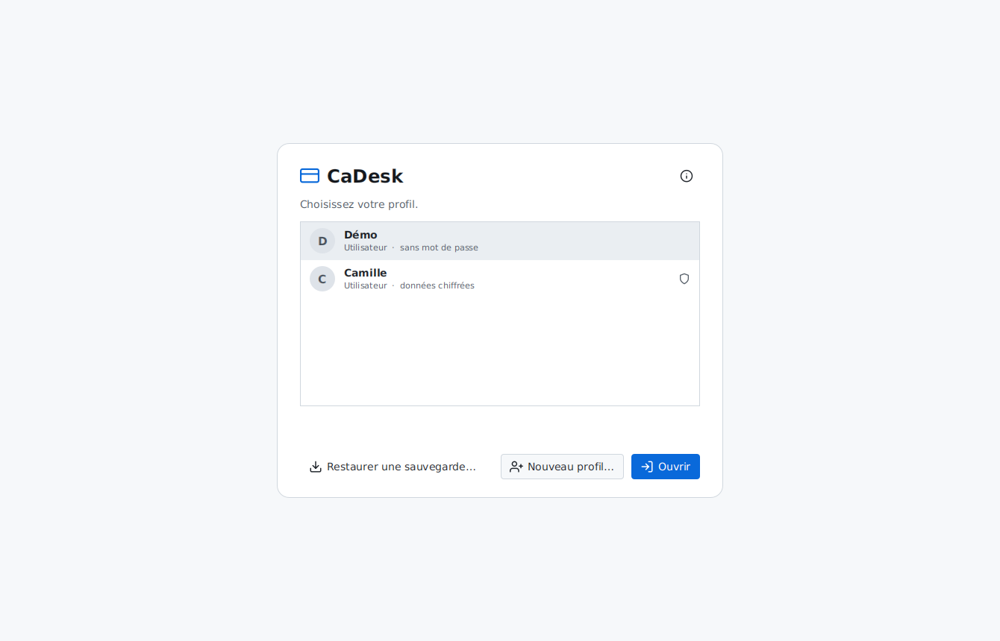
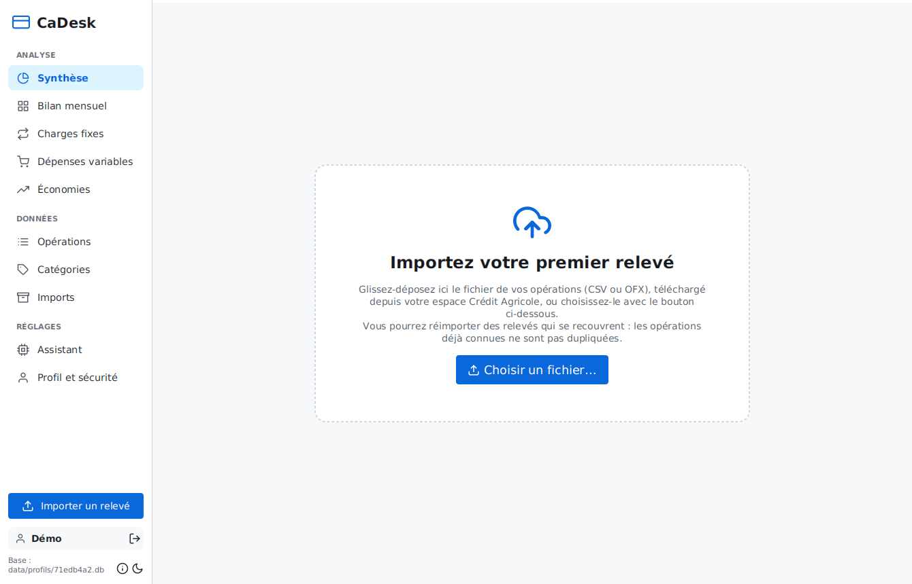
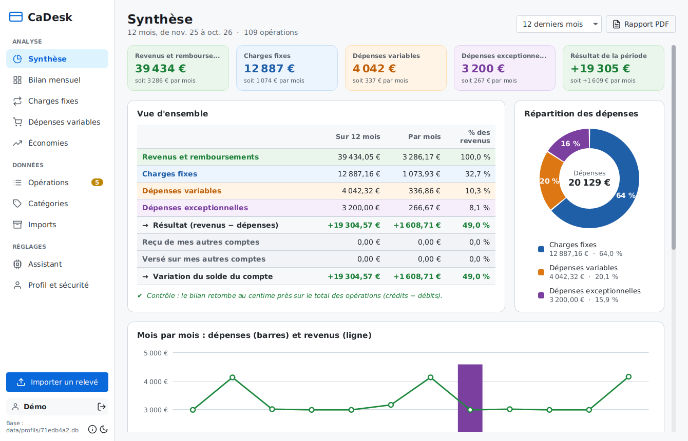
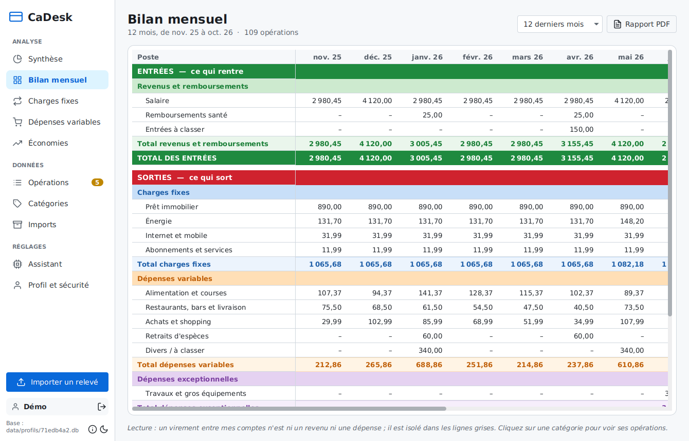
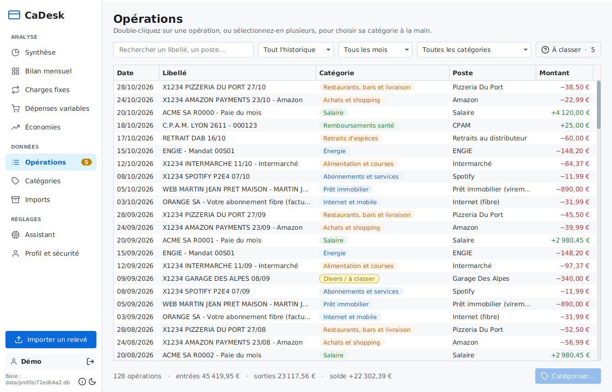
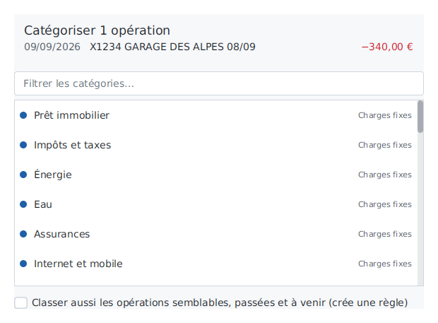
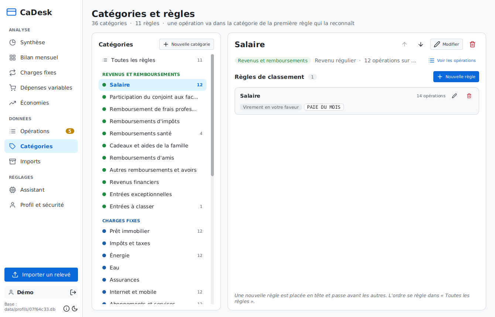
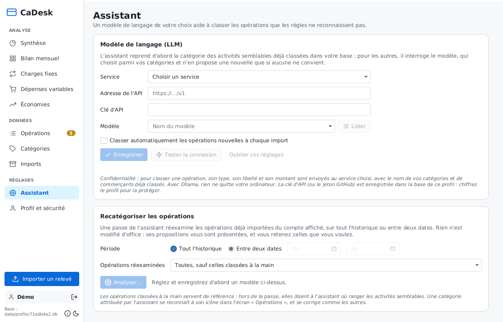
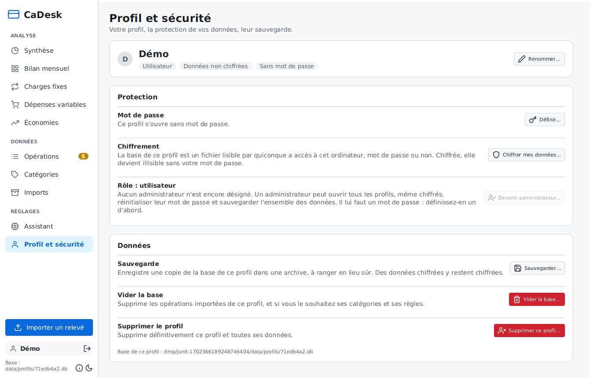
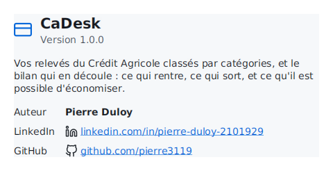

# CaDesk — guide d'utilisation

CaDesk range les opérations de vos comptes du Crédit Agricole par catégories et en tire votre bilan : ce qui
rentre, ce qui sort, vos charges fixes, vos dépenses variables et ce qu'il est possible d'économiser.

Tout se passe sur votre ordinateur : vos relevés ne sont envoyés nulle part, sauf si vous choisissez d'utiliser
l'assistant (voir [L'assistant](#7-lassistant-facultatif)).

**Sommaire**

1. [Installer l'application](#1-installer-lapplication)
2. [Premier lancement : votre profil](#2-premier-lancement--votre-profil)
3. [Récupérer un relevé auprès de la banque](#3-récupérer-un-relevé-auprès-de-la-banque)
4. [Importer un relevé](#4-importer-un-relevé)
5. [Lire votre bilan](#5-lire-votre-bilan)
6. [Classer vos opérations](#6-classer-vos-opérations)
7. [L'assistant (facultatif)](#7-lassistant-facultatif)
8. [Le rapport PDF](#8-le-rapport-pdf)
9. [Profils, mot de passe, chiffrement et sauvegarde](#9-profils-mot-de-passe-chiffrement-et-sauvegarde)
10. [Questions fréquentes](#10-questions-fréquentes)

---

## 1. Installer l'application

### Ce qu'il vous faut

- un ordinateur sous **Windows** ou sous **Linux** (64 bits) ;
- environ 700 Mo de place ;
- le dossier de l'application, souvent nommé `app_clean` — on vous l'a remis tel quel, ou dans une archive
  `.zip` qu'il suffit de décompresser.

Il n'y a **rien d'autre à installer** : tout ce dont l'application a besoin est dans ce dossier.

### Mettre le dossier où vous voulez

Placez le dossier à l'endroit qui vous convient — vos documents, un disque externe, une clé USB — et donnez-lui
le nom que vous voulez. Vous pourrez le déplacer plus tard : vos données sont **dans** ce dossier (sous-dossier
`data`) et le suivent.

### Lancer l'application

| Votre système | Ce qu'il faut faire                                                                 |
|---------------|-------------------------------------------------------------------------------------|
| Windows       | Ouvrez le dossier et double-cliquez sur **`start.bat`**                             |
| Linux         | Ouvrez un terminal dans le dossier et tapez **`./start.sh`**                        |

Sous Windows, si un avertissement de sécurité s'affiche à la première ouverture, confirmez que vous voulez
ouvrir le fichier. Le premier démarrage prend quelques secondes de plus que les suivants.

> Si rien ne se passe sous Windows, lancez `start.bat --console` depuis une invite de commandes : le message
> d'erreur s'y affiche. Sur un poste d'entreprise qui interdit les fichiers `.bat`, voyez le fichier `README.md`
> du projet.

### Mettre à jour, désinstaller

- **Mettre à jour** : dans le nouveau dossier de l'application, copiez le sous-dossier `data` de l'ancien.
  Vous retrouvez vos profils et vos opérations.
- **Désinstaller** : supprimez le dossier. Vos données partent avec lui : faites d'abord une
  [sauvegarde](#sauvegarder-et-restaurer) si vous voulez les garder.

---

## 2. Premier lancement : votre profil

Chaque personne qui utilise l'application a son **profil** : ses comptes, ses opérations, ses catégories, ses
réglages. Au premier lancement, créez le vôtre avec **Nouveau profil…** : un nom suffit.

Deux protections sont proposées, toutes deux facultatives, que vous pourrez aussi régler plus tard :

- un **mot de passe**, demandé à chaque ouverture du profil ;
- le **chiffrement** de vos données, qui les rend illisibles sans ce mot de passe.

Tant qu'il n'y a qu'un profil, sans mot de passe, l'application l'ouvre directement. Le petit bouton **(i)**
indique qui a réalisé l'application.

---

## 3. Récupérer un relevé auprès de la banque

Dans votre espace client du Crédit Agricole, sur le site de la banque, ouvrez le compte qui vous intéresse et
utilisez le **téléchargement des opérations**. Choisissez la période, puis l'un de ces deux formats :

| Format  | Ce qu'il contient                                                                                  |
|---------|----------------------------------------------------------------------------------------------------|
| **CSV** | Chaque opération en entier : le nom du commerçant, les références, la date de valeur. **À préférer.** |
| **OFX** | Un résumé de chaque opération : sa date, son montant et l'essentiel de son libellé.                |

Téléchargez **un fichier par compte**. Gardez ces fichiers pour vous : ils contiennent vos données bancaires.

Vous pouvez mélanger les deux formats au fil du temps. Si une même opération arrive par un relevé OFX puis par un
relevé CSV, l'application la reconnaît et complète son libellé ; dans l'autre sens, elle garde le libellé complet.

---

## 4. Importer un relevé

Cliquez sur **Importer un relevé**, en bas à gauche, et choisissez le fichier — ou faites-le simplement glisser
sur la fenêtre. Plusieurs fichiers peuvent être importés d'un coup.

Un bandeau vous dit ce que l'import a apporté : combien d'opérations ont été ajoutées, combien étaient déjà
connues.

**Vous ne risquez pas de doublons.** Vous pouvez réimporter un fichier, ou importer un relevé dont la période
recouvre celle d'un relevé précédent : seules les opérations réellement nouvelles sont ajoutées. L'habitude la
plus simple est donc de télécharger, de temps en temps, les derniers mois et de les importer tels quels.

L'écran **Imports** garde la trace de chaque fichier importé.

---

## 5. Lire votre bilan

Les cinq premiers écrans du menu, sous **Analyse**, présentent vos comptes sous des angles différents.

| Écran                  | Ce que vous y trouvez                                                                    |
|------------------------|------------------------------------------------------------------------------------------|
| **Synthèse**           | Les chiffres clés, la répartition de vos dépenses, leur évolution mois par mois, vos plus gros postes |
| **Bilan mensuel**      | Un tableau des entrées et des sorties, par catégorie et par mois, avec le solde de chaque mois |
| **Charges fixes**      | Chaque charge qui revient : combien de paiements, à quel montant, et comment il évolue    |
| **Dépenses variables** | Vos dépenses par catégorie, puis les commerçants chez qui vous dépensez le plus           |
| **Économies**          | Ce que vous mettez de côté, et un simulateur : « et si je réduisais ce poste de 20 % ? »  |

### Choisir la période

En haut à droite de ces écrans, une liste fixe la période étudiée : les **12 derniers mois**, une **année**,
**tout l'historique**, ou **entre deux dates**. Dans ce dernier cas, deux champs de date apparaissent ; il n'y a
rien à valider, le bilan se met à jour dès qu'une date est choisie. Laissée vide, une date ne limite rien.

### Comprendre les couleurs

Le bilan distingue cinq natures d'opérations, chacune avec sa couleur :

- les **revenus et remboursements** ;
- les **charges fixes**, qui reviennent chaque mois ou chaque année ;
- les **dépenses variables**, celles du quotidien ;
- les **dépenses exceptionnelles**, comme de gros travaux ;
- les **virements entre vos propres comptes**, qui ne sont ni un revenu ni une dépense, et sont comptés à part.

Dans tous ces écrans, **cliquez sur une catégorie ou sur un poste** pour voir les opérations qui le composent.

---

## 6. Classer vos opérations

Chaque opération est rangée dans une catégorie par des **règles** : « un paiement par carte dont le libellé
contient SNCF va dans Transports ». L'application est livrée avec des catégories générales, mais sans règle : les
règles sont les vôtres, et se créent au fil du classement. Ce qu'aucune règle ne reconnaît — donc tout, après
votre premier import — attend dans **Divers / à classer** (pour une sortie) ou **Entrées à classer** (pour une
entrée) : la pastille à côté d'**Opérations** en donne le nombre.

### Classer une opération

Dans l'écran **Opérations**, double-cliquez sur une opération — ou sélectionnez-en plusieurs puis cliquez sur
**Catégoriser…** — et choisissez sa catégorie.

Cochez **Classer aussi les opérations semblables** pour que l'application retienne la leçon : elle crée une
règle à partir du commerçant, reclasse les opérations passées qui lui correspondent, et classera les prochaines.
C'est le moyen le plus rapide de mettre de l'ordre : quelques dizaines de clics suffisent en général.

L'écran **Opérations** permet aussi de chercher un libellé et de filtrer par période, par mois et par catégorie.

### Régler les catégories et les règles

L'écran **Catégories** montre vos catégories, classées par nature, et pour chacune ses règles.

- **Nouvelle catégorie** crée une catégorie ; **Modifier** change son nom ou sa nature.
- **Nouvelle règle** ajoute une règle à la catégorie affichée : un type d'opération (paiement par carte,
  prélèvement, virement…) et un ou plusieurs **mots-clés** à trouver dans le libellé. Majuscules et accents ne
  comptent pas.
- Les règles sont essayées dans l'ordre, et la première qui convient l'emporte. **Toutes les règles** permet de
  changer cet ordre.

Modifier une règle s'applique aussitôt à tout votre historique : rien n'est à réimporter.

---

## 7. L'assistant (facultatif)

L'assistant classe à votre place les opérations que vos règles ne reconnaissent pas. Il regarde d'abord si une
opération semblable est déjà classée chez vous ; sinon, il demande à un **modèle de langage** (une intelligence
artificielle) de choisir parmi vos catégories.

### Le mettre en route

Dans l'écran **Assistant**, choisissez un **service** — OpenAI, Anthropic, Mistral, Google Gemini, GitHub
Copilot, Ollama, ou un autre service compatible — puis renseignez ce qu'il demande, en général une clé fournie
par ce service. **Tester la connexion** vérifie vos réglages ; **Enregistrer** les retient.

Avec **GitHub Copilot**, il n'y a pas de clé à saisir : cliquez sur **Se connecter à GitHub…**, autorisez la
connexion dans la page qui s'ouvre dans votre navigateur, puis revenez à l'application.

### S'en servir

- **À l'import** : cochez « Classer automatiquement les opérations nouvelles à chaque import ». La case
  **Classer avec l'assistant**, sous le bouton d'import, l'active ou le suspend d'un clic.
- **Sur ce qui est déjà importé** : la partie **Recatégoriser les opérations** réexamine vos opérations, sur
  tout l'historique ou entre deux dates. Rien n'est changé d'office : l'assistant vous présente ses
  propositions, et vous cochez celles que vous acceptez.

### Ce qui quitte votre ordinateur

Pour classer une opération, son type, son libellé et son montant sont envoyés au service choisi, avec le nom de
vos catégories. Si vous ne le souhaitez pas, n'activez pas l'assistant — ou choisissez **Ollama**, qui fonctionne
entièrement sur votre ordinateur.

---

## 8. Le rapport PDF

Le bouton **Rapport PDF**, à côté du choix de la période, enregistre un document qui reprend les chiffres et les
graphiques de tous les écrans de bilan pour la période affichée. Vous pouvez y joindre la liste détaillée des
opérations.

Ce document contient vos données bancaires : rangez-le en conséquence.

---

## 9. Profils, mot de passe, chiffrement et sauvegarde

Tout se règle dans l'écran **Profil et sécurité**.

### Protéger votre profil

- **Mot de passe** : il sera demandé à chaque ouverture du profil.
- **Chiffrement** : sans lui, le mot de passe n'est qu'une porte, et vos données restent lisibles par quelqu'un
  qui fouillerait l'ordinateur. Chiffrées, elles sont illisibles sans le mot de passe.

> **Attention** : si vous oubliez le mot de passe d'un profil chiffré, ses données sont perdues, sauf si un
> administrateur a été désigné auparavant.

### Plusieurs personnes

Le nom de votre profil est rappelé en bas du menu ; le bouton à sa droite ferme le profil pour en ouvrir un
autre. Chaque profil est indépendant des autres.

Un profil protégé par un mot de passe peut devenir **administrateur**. Un administrateur peut ouvrir tous les
profils, redonner un mot de passe à celui qui a oublié le sien, et sauvegarder tous les profils en une fois.

### Sauvegarder et restaurer

**Sauvegarder…** enregistre vos données dans un fichier `.zip`. Rangez-le ailleurs que sur l'ordinateur — un
disque externe, par exemple. Les données d'un profil chiffré y restent chiffrées.

Pour retrouver vos données, sur cet ordinateur ou sur un autre, utilisez **Restaurer une sauvegarde…** dans
l'écran de choix du profil : le profil est recréé à côté de ceux qui existent, sans rien remplacer.

### Repartir de zéro

**Vider la base…** supprime les opérations du profil ; une case permet de supprimer aussi vos règles et de
retrouver les catégories du premier jour. **Supprimer ce profil…** efface le profil et toutes ses données.

---

## 10. Questions fréquentes

**J'ai importé deux fois le même relevé. Ai-je des doublons ?**
Non. Les opérations déjà connues sont reconnues et ne sont pas ajoutées une seconde fois.

**Où sont mes données ?**
Dans le sous-dossier `data` du dossier de l'application. Seule exception : sous Windows, si ce dossier se trouve
sur un partage réseau, les données sont rangées dans votre dossier personnel. L'emplacement exact est toujours
rappelé en bas du menu.

**Puis-je déplacer l'application sur un autre ordinateur ?**
Oui : copiez le dossier entier, données comprises. Il fonctionne sous Windows comme sous Linux.

**Beaucoup d'opérations sont « à classer ». Est-ce normal ?**
Oui, au début : l'application n'a aucune règle tant que vous n'en avez pas créé. Classez quelques opérations en
cochant « Classer aussi les opérations semblables » (voir [Classer vos opérations](#6-classer-vos-opérations)), ou
laissez faire l'assistant.

**Mon relevé est refusé.**
L'application lit les relevés CSV et OFX du Crédit Agricole, un compte par fichier. Le message indique ce qui ne
va pas ; un fichier refusé ne modifie rien.

**Peut-on passer en thème sombre ?**
Oui : le bouton en forme de lune, tout en bas du menu.

**Qui a réalisé cette application ?**
Pierre Duloy — [LinkedIn](https://www.linkedin.com/in/pierre-duloy-2101929/),
[GitHub](https://github.com/pierre3119). Ces liens se retrouvent dans l'application, sous le bouton **(i)**.

